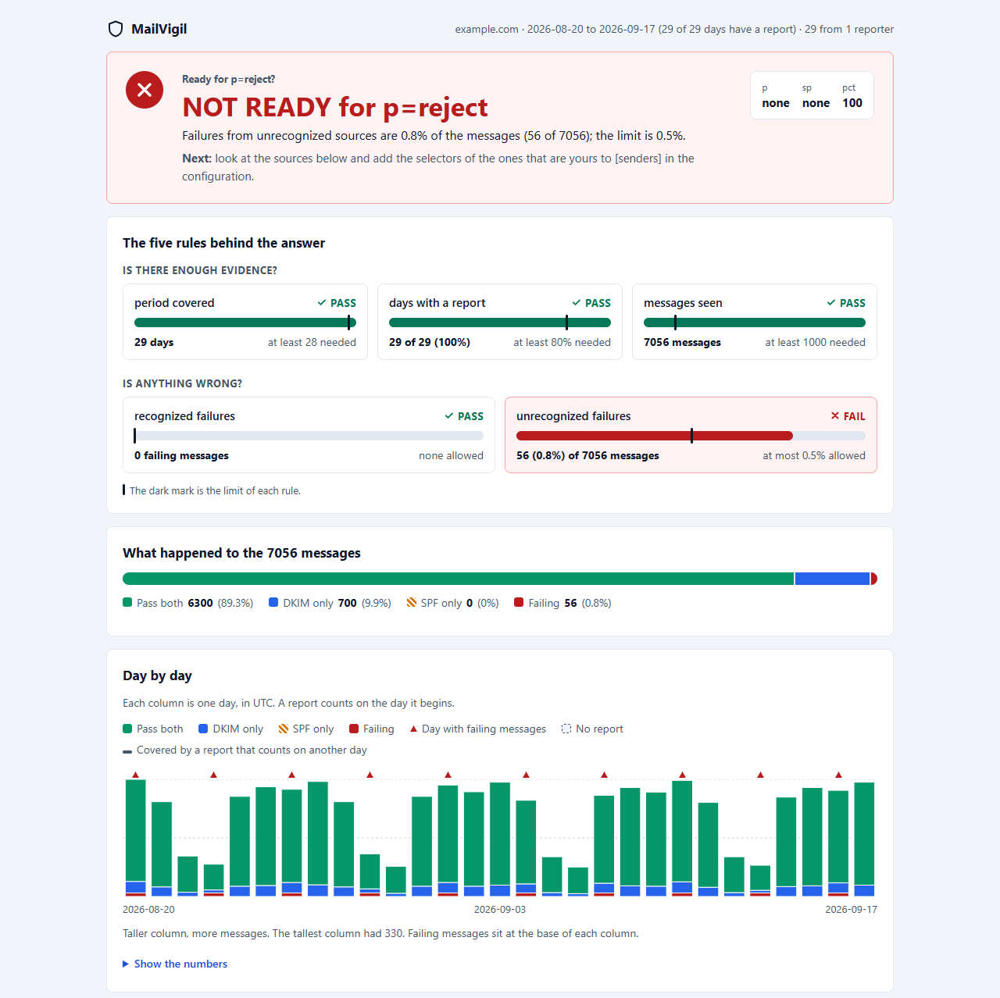

#  MailVigil

[English](README.md) · **Português (Brasil)**


[](https://github.com/ryanvmorais/mailvigil/actions/workflows/ci.yml)
[](https://pypi.org/project/mailvigil/)
[](https://github.com/ryanvmorais/mailvigil/releases)


**O MailVigil é um analisador de relatórios DMARC offline e sem dependências: uma ferramenta de
linha de comando que lê os relatórios agregados (RUA) que seus provedores de e-mail enviam e diz,
em linguagem simples, quem está enviando e-mail em nome do seu domínio e se é seguro mudar a sua
política para `p=reject`.**

Quem implanta o DMARC recebe todo dia um arquivo XML (geralmente dentro de um `.zip` ou `.gz`) de
cada provedor, e ninguém lê. O resultado são pessoas que ficam em `p=none` para sempre, com medo de
bloquear e-mail legítimo. O MailVigil lê por você, agrupa o tráfego por remetente e entrega um
veredito com um critério explícito e documentado, em vez de uma parede de números.

Ele é feito para donos de sites, desenvolvedores, agências e freelancers de infraestrutura que estão
implantando o DMARC, e roda inteiro na sua máquina: seus relatórios nunca são enviados a ninguém.

> **Status:** estável, desde a `1.0.0`. Os comandos, os códigos de saída, os documentos do `--json`
> e o arquivo de configuração são um contrato que só muda numa versão major; o que é público e o
> que não é está em [docs/stability.md](docs/stability.md) (em inglês).

**Instalação:** `pipx install mailvigil` ou `uv tool install mailvigil` (Python 3.12 ou mais novo,
nada além disso). Depois, `mailvigil verdict --config mailvigil.toml reports/ --lang pt-BR`.


*Duas execuções reais sobre relatórios inventados (`example.com`, endereços de documentação): o
primeiro período é `NOT READY` e o comando sai com `4`; depois que o remetente corrige a chave
DKIM, um mês de relatórios mais novos dá `READY` e `0`. A gravação está em inglês, que é o idioma
padrão da ferramenta; com `--lang pt-BR` o texto sai como nos exemplos mais abaixo. Os comandos são
digitados para a gravação e a espera entre as duas execuções foi cortada. A gravação é o arquivo
[`docs/demo/verdict.cast`](docs/demo/verdict.cast), feito por
[`docs/demo/build_demo.py`](docs/demo/build_demo.py); toque com `asciinema play`.*

## O que ele faz

O MailVigil é construído marco a marco, cada um desenhado primeiro como uma spec, em
[`specs/`](specs/). Os marcos são o histórico da construção, não versões publicadas: a `1.0.0` é a
primeira versão e contém do `v0.1` ao `v0.9`.

| Marco | Foco | Status |
|---|---|---|
| `v0.1` | Ler uma pasta ou arquivos (`.zip`, `.gz`, `.xml`), filtrar por domínio; entrada hostil: limitar o tamanho descompactado (zip bombs) e recusar XML com `DOCTYPE` ou `ENTITY` (expansão de entidades) | entregue |
| `v0.2` | Configuração: um arquivo TOML com o seu domínio e um mapa de seletor DKIM para nome do serviço; uma assinatura só vale sob o seu próprio domínio | entregue |
| `v0.3` | `mailvigil summary`: por remetente e por situação (ok, frágil, com falha), falhas em destaque | entregue |
| `v0.4` | `mailvigil verdict`: "Pronto para `reject`?" com um critério declarado: 28 dias cobertos, relatórios em 80% dos dias, 100 mensagens, nenhuma falha de remetente reconhecido, no máximo 0,5% das mensagens falhando de origens não reconhecidas | entregue |
| `v0.5` | `--json` e códigos de saída estáveis para scripts e CI; o texto em inglês ou português do Brasil (`--lang pt-BR`) | entregue |
| `v0.6` | Mensagens de e-mail como entrada: `.eml` e `.mbox`, com o anexo do relatório extraído em memória | entregue |
| `v0.7` | `mailvigil verdict --html`: uma página estática com o veredito, cada regra diante do seu limite e as mensagens dia a dia; sem script, sem rede, aberta direto do disco | entregue |
| `v0.8` | `mailvigil fetch`: baixa as mensagens de relatório de uma caixa de correio por IMAP para uma pasta, opt-in, somente leitura, sempre sobre TLS verificado | entregue |
| `v0.9` | Endurecimento antes do release: limites para a contagem e o período de um relatório, um dia conta como coberto por tempo, avisos para dados velhos e para um remetente de relatórios que ficou quieto, e códigos de saída distintos para um bug, Ctrl+C e um pipe fechado | entregue |

Fora do plano, de propósito: indexar no Elasticsearch, um painel web servido pela ferramenta e o
envio de e-mail, cada um com o seu motivo em [Não-objetivos permanentes][non-goals] (em inglês).

## Configuração

O MailVigil dá nome a um remetente a partir do seletor DKIM que aparece nos relatórios, usando um
mapa que você escreve. O arquivo é TOML, e os nomes abaixo são inventados:

```toml
domain = "example.com"

[senders]
newsletter = "Example Mailer (newsletters)"
mailbox = "Example Mail (staff mailboxes)"
"k1.v2" = "Example Campaigns"
```

- **Comece com o `[senders]` vazio** e preencha a partir do que o primeiro resumo mostrar como
  desconhecido.
- **Um seletor precisa identificar um único serviço.** Nomes como `default` são compartilhados por
  serviços sem relação, então o MailVigil não traz tabela embutida e mostra um remetente fora da
  lista como desconhecido.
- **Um seletor com ponto vai entre aspas** (`"k1.v2"`). Sem elas, o TOML lê `k1.v2` como uma tabela
  aninhada e o MailVigil recusa o arquivo.
- **Um seletor sozinho não é confiável.** Ele dá nome a um serviço só quando há uma assinatura DKIM
  válida sob o seu domínio ou um subdomínio dele; o mesmo seletor sob outro domínio é apontado
  como domínio estrangeiro.
- **O arquivo é estrito.** Uma chave desconhecida (`domian`), um seletor repetido ou um caractere de
  controle num nome é um erro com motivo, nunca um palpite silencioso, porque um erro de digitação
  mudaria a resposta.

`mailvigil summary --config ARQUIVO` lê o arquivo. Sem `--config`, o comando lê o `mailvigil.toml`
da pasta atual, se houver; sem arquivo e sem `--domain`, ele pede um deles.

## MailVigil e outras ferramentas

| | MailVigil | [parsedmarc](https://github.com/domainaware/parsedmarc) | Serviços hospedados (dmarcian, EasyDMARC, Postmark) |
|---|---|---|---|
| Formato | Uma CLI pequena, só biblioteca padrão | Parser e pipeline para Elasticsearch, Splunk e Kibana | Painéis web |
| Para onde vão seus relatórios | Para lugar nenhum: offline | Para a sua própria stack | Para um terceiro |
| Resposta | Um veredito sobre `p=reject` com critério declarado | Dados já interpretados (JSON, CSV, painéis) | Painéis e recomendações |
| Ideal para | Decidir se dá para impor o DMARC, pelo terminal | Monitoramento contínuo em escala | Times que querem um produto gerenciado |

O MailVigil não substitui um pipeline de monitoramento: se você já roda o parsedmarc, continue com
ele. O MailVigil responde a uma pergunta só, e responde sem uma stack para instalar.

## Escopo e limitações

O MailVigil é pequeno de propósito. Para cada limite abaixo, o que usar no lugar.

- **Ele lê só os relatórios que você der.** E-mail que nenhum receptor reporta, e remetentes que
  ficaram quietos no período, não são cobertos, e o veredito diz isso sob toda resposta. *No
  lugar:* colete um ciclo completo primeiro; o veredito pede 28 dias.
- **O `fetch` não tem OAuth.** Ele entra com nome e senha, então contas do Microsoft 365 e do
  Google sem senha de app não são suportadas (veja [Fetch](#fetch)). *No lugar:* salve as
  mensagens de relatório do seu cliente de e-mail numa pasta como arquivos `.eml` e aponte o
  `summary` para ela. Vale o mesmo para um provedor sem IMAP.
- **Não é um pipeline de monitoramento.** Não há painéis, histórico nem alertas, e um painel web
  não está nos planos (veja [Não-objetivos permanentes][non-goals]). *No lugar:*
  [parsedmarc](https://github.com/domainaware/parsedmarc) com Elasticsearch ou Kibana.

## Começando

Instale como um comando, com o [pipx](https://pipx.pypa.io/) ou o [uv](https://docs.astral.sh/uv/).
Ele precisa do Python 3.12 ou mais novo e de nada além disso.

```bash
# Instale o comando (um dos dois)
pipx install mailvigil
uv tool install mailvigil

# Confira que o comando roda
mailvigil --version

# Resuma uma pasta de relatórios (ou nomeie os arquivos); o mailvigil.toml é lido se estiver aqui
mailvigil summary reports/
mailvigil summary --config mailvigil.toml reports/
mailvigil summary --domain example.com report.xml.gz

# Pergunte se o domínio está pronto para p=reject (mesmos argumentos do summary)
mailvigil verdict --config mailvigil.toml reports/

# As mesmas respostas como um documento JSON, para um script ou um job de CI
mailvigil verdict --config mailvigil.toml reports/ --json

# O texto em português do Brasil (o inglês é o padrão)
mailvigil verdict --config mailvigil.toml reports/ --lang pt-BR

# Uma página HTML para abrir no navegador (redirecione para um arquivo)
mailvigil verdict --config mailvigil.toml reports/ --html > report.html

# Traga as mensagens de relatório de uma caixa de correio (pede a senha) e depois leia
mailvigil fetch --host imap.example.com --user me@example.com --to reports/
```

O `summary` e o `verdict` imprimem o texto e mais nada; só leem os seus arquivos e não tocam na
rede. Só o `fetch` se conecta a um servidor (veja [Fetch](#fetch)).
Uma pasta é vasculhada, um nível de profundidade, apenas atrás dos nomes que os provedores usam nos
anexos (`provedor!dominio!inicio!fim.zip`, também `.gz` e `.xml`) e dos arquivos `.eml` e `.mbox`,
cujos anexos de relatório são extraídos das mensagens em memória. Um arquivo nomeado na linha de
comando é lido seja qual for o nome. Acrescente `--recursive` para vasculhar também as subpastas
(até 8 níveis; uma pasta que é link não é percorrida). Um arquivo `.zip`, `.gz` ou `.xml` com outro
nome não é lido, mas o bloco "left out" o conta como "passed over by name" (ignorado pelo nome), e
um relatório renomeado não passa em silêncio: nomeie o arquivo para lê-lo.

Os textos de exemplo abaixo estão em português porque levam `--lang pt-BR`. Sem essa opção, o
texto sai em inglês, com as mesmas linhas e os mesmos números.

<details>
<summary>O que o <code>summary</code> imprime (dados inventados)</summary>

```text
Resumo do MailVigil para example.com
  config      mailvigil.toml (3 seletores)
  periodo     2026-10-20 a 2026-10-20 (1 de 1 dia com relatorio)
  relatorios  1 de 1 provedor
  politica    p=none, sp=none, pct=100
  mensagens   7335 (7250 de remetentes reconhecidos, 98.8%)

Situacoes
  ok       6300  85.9%
  fragil    975  13.3%
  falha      60   0.8%

Remetentes
  remetente                               ok  fragil  falha  total
  Example Mailer (newsletters)          6300       0      0   6300
  Example Mail (staff mailboxes)           0     950      0    950
! 203.0.113.5 (nao reconhecido)            0       0     40     40
  198.51.100.99 (assinatura com falha)     0      25      0     25
! 203.0.113.9 (nao reconhecido)            0       0     12     12
! 2001:db8::7 (nao reconhecido)            0       0      8      8

! FALHA: 60 mensagens em 3 origens
  Origens nao reconhecidas que falham
  ! 203.0.113.5
      40 mensagens  dkim: fail, spf: fail
  ! 203.0.113.9
      12 mensagens  dkim: none, spf: fail
  ! 2001:db8::7
      8 mensagens  dkim: none, spf: none

Fora destes numeros
  arquivos ignorados  0
  duplicados          0
  outros dominios     0
```

Um `!` marca um remetente com mensagens que falharam. Arquivos recusados, duplicados e relatórios de
outro domínio são contados no fim, para que nenhum número suma em silêncio.

</details>

### O veredito

O `mailvigil verdict` responde uma de três coisas, cada uma com a regra que decidiu. Este é um
`NAO PRONTO` (dados inventados):

```text
Veredito do MailVigil para example.com: NAO PRONTO para p=reject

Motivo: as falhas de origens nao reconhecidas sao 0.8% das mensagens (56 de
        7056); o limite e 0.5%.
  203.0.113.5  nao reconhecido: 56 mensagens com falha

Regras
  regra                       medido           necessario  resultado
  1  periodo coberto          29 dias          >= 28       passa
  2  dias com relatorio       29 de 29 (100%)  >= 80%      passa
  3  mensagens vistas         7056             >= 100      passa
  4  falhas reconhecidas      0                <= 0        passa
  5  falhas nao reconhecidas  56 (0.8%)        <= 0.5%     FALHA

Proximo: olhe as origens acima e acrescente os seletores das que forem suas a
         [senders] na configuracao.

Isto le apenas os relatorios que voce deu: email que nenhum receptor reporta, e
remetentes que ficaram quietos neste periodo, nao sao cobertos.
```

`PRONTO` significa que todas as regras passam. `CEDO DEMAIS` significa que as regras de dados (1 a
3) falham e nada está falhando ainda: espere por mais relatórios. `NAO PRONTO` significa que uma
origem falha (regras 4 e 5), e o comando diz qual.

Quando há arquivos recusados, duplicados ou de outro domínio, o veredito acrescenta uma linha
dizendo isso; o `mailvigil summary` mostra o motivo. Eles nunca mudam a resposta.

### Relatório HTML

O `mailvigil verdict --html` imprime uma página HTML autocontida no lugar do texto, para ler a
resposta numa tela ou mandá-la a quem não vai abrir um terminal. A página abre com a resposta e
mostra cada uma das cinco regras como um medidor diante do seu limite, a divisão das mensagens em
quatro situações, uma coluna por dia do período, os remetentes e as origens que falham. Ela segue o
`--lang`, muda para o tema escuro junto com o sistema e imprime bem em papel.

<picture>
  <source media="(prefers-color-scheme: dark)" srcset="docs/images/dmarc-reject-verdict-html-report-dark.png">
  
</picture>

*A página de um domínio inventado (`example.com`, endereços de documentação), na paleta clara e na
escura: origens não reconhecidas falham em 0,8% das mensagens (56 de 7056), acima do limite de
0,5%, então a resposta é `NOT READY`. A imagem foi gerada em inglês; com `--lang pt-BR` a página
sai em português.*

```bash
mailvigil verdict --config mailvigil.toml reports/ --html > report.html
```

- **É um arquivo, não um servidor.** A página não tem script, não carrega nada da rede e declara
  uma política de segurança de conteúdo que proíbe os dois; o texto dos seus relatórios é escapado
  antes de chegar ao markup. Abra direto do disco.
- **Ela não carrega caminho nem nome de arquivo**, só o que os relatórios dizem, então pode ser
  compartilhada como está quando você aceitar mostrar nela o domínio e os endereços de envio.
- **O código de saída é o mesmo** de quando não há `--html` (`0`, `3`, `4`), e o `--html` não pode
  ser combinado com o `--json`. O `summary` não tem `--html`.
- **O `--output FILE` grava a página por conta própria**, em bytes ASCII, sem shell no meio:
  `mailvigil verdict --config mailvigil.toml reports/ --html --output report.html`. Ele substitui
  um arquivo que já exista, nunca cria a pasta, não imprime nada quando dá certo e exige `--html`.
  Use-o no **Windows PowerShell 5.1**, cujo `>` grava UTF-16, que os navegadores não leem como a
  página espera. A página é ASCII, então o `>` de qualquer outro shell também funciona.

### Fetch

O `mailvigil fetch` salva as mensagens de relatório DMARC de uma caixa de correio, intactas, como
arquivos `.eml` numa pasta; o `summary` e o `verdict` leem essa pasta depois. É o único comando que
abre uma conexão de rede, e o `summary` e o `verdict` nunca carregam o código dele.

```bash
# Peça a senha no terminal
mailvigil fetch --host imap.example.com --user me@example.com --to reports/

# Só e-mail recente, no máximo 200 mensagens, a senha lida de um arquivo (para o cron)
mailvigil fetch --host imap.example.com --user me@example.com --to reports/ \
  --since 2026-10-01 --limit 200 --password-file ~/.mailvigil-password
```

O que ele faz:

- Procura em `INBOX` (ou em `--folder`) as mensagens cujo assunto tem `Report Domain:`, o assunto que
  os provedores usam nos relatórios, e salva cada uma como `<tag>-<validade>-<uid>.eml`.
- É incremental: rode de novo e só as mensagens novas são salvas, então ele pode rodar pelo `cron`.
  O `--limit` (padrão 500, no máximo 10000) limita uma execução e pega as mais novas primeiro.
- Imprime seis números (encontradas, salvas, já salvas, grandes demais, ignoradas, deixadas para a
  próxima execução) e a pasta, nunca um assunto, remetente ou endereço.

O que ele não faz:

- Nunca altera a caixa de correio: nada de apagar, mover ou marcar, e as mensagens não ficam
  marcadas como lidas.
- Nunca se conecta sem TLS, e o certificado é sempre verificado. Não existe opção para desligar
  isso, nem IMAP sem criptografia, nem STARTTLS (o `--port` padrão é 993). Um servidor atrás de
  uma autoridade certificadora privada é aceito com `--cafile ARQUIVO` (um arquivo PEM), que soma
  essa autoridade às do sistema e continua verificando o certificado e o nome do servidor.
- A senha é pedida no terminal ou lida da primeira linha do `--password-file`. Ela nunca é um
  argumento nem uma variável de ambiente, e nada a guarda.
- Não interpreta os relatórios: ele salva bytes, e a ingestão os lê.

Seu provedor não tem IMAP? O `fetch` precisa de um, e muitos planos gratuitos de e-mail não o
oferecem. Então baixe as mensagens de relatório à mão (salve cada uma como `.eml`, ou salve os
anexos) numa pasta e aponte o `summary` ou o `verdict` para ela: tudo, menos o download, funciona
igual. Quando um login é recusado ou o servidor não pode ser alcançado, a mensagem diz isso.

Limites de provedor: ele entra com nome e senha (`LOGIN`), sem OAuth. O Gmail funciona com uma
[senha de app](https://support.google.com/accounts/answer/185833) (com a verificação em duas etapas
ligada). Contas do Microsoft 365 e do Google sem senha de app não são suportadas nesta versão. Um
nome ou senha com caractere fora do ASCII é enviado com `AUTHENTICATE PLAIN` em UTF-8, e só se o
servidor oferecer esse método; do contrário a execução é recusada.

Códigos de saída: `0` quando a execução terminou, mesmo sem nada novo; `1` quando foi recusada (o
motivo é impresso numa linha); `2` para erro de uso; `70` para um bug (veja abaixo).

### Códigos de saída

O código de saída é um contrato: um script distingue "sim", "espere" e "não" de "não consegui
rodar" sem ler o texto. O `--json` não o altera.

| Código | Significado | Comandos |
|---|---|---|
| `0` | Uma resposta foi impressa; no `verdict`, a resposta é `ready`; no `fetch`, a execução terminou | todos |
| `1` | A execução foi recusada: configuração ou domínio inválido, nenhum relatório aproveitado ou (no `fetch`) falha de conexão, login ou pasta | todos |
| `2` | Erro de uso (uma opção desconhecida, um argumento faltando) | todos |
| `3` | O `verdict` imprimiu `too early`: espere por mais relatórios | `verdict` |
| `4` | O `verdict` imprimiu `not ready`: uma origem falha | `verdict` |
| `70` | Erro interno, um bug: uma linha na saída de erro diz onde; por favor, reporte | todos |
| `130` | Interrompido com Ctrl+C | todos |
| `141` | O pipe de saída foi fechado (`mailvigil verdict ... \| head`) | todos |

Repare que `1` é uma recusa e `4` é "não pronto"; um script que trata todo código diferente de zero
do mesmo jeito confunde os dois:

```bash
mailvigil verdict reports/ --domain example.com --json > verdict.json
case $? in
  0) echo "pronto para p=reject" ;;
  3) echo "cedo demais: continue coletando relatórios" ;;
  4) echo "não pronto: veja o verdict.json" ;;
  *) echo "o mailvigil não conseguiu rodar" >&2 ;;
esac
```

Mudar esta tabela é uma quebra de compatibilidade. O [docs/stability.md](docs/stability.md) lista o
que mais é público e o que não é.

### JSON

O `--json` no `summary` ou no `verdict` imprime um documento JSON e uma quebra de linha na saída
padrão, e nada na saída de erro. O documento é dado, não texto: inteiros, booleanos, identificadores
e os valores dos relatórios, sem frase e sem porcentagem arredondada. Ele traz todos os remetentes
e todas as origens que falham, sem os limites que o texto mantém, e um valor que pode não existir
(ainda sem período, sem `sp`) é `null`. Uma execução recusada não imprime documento: a linha única
vai para a saída de erro, como sem `--json`, e o código de saída é `1`. O
[docs/json-schema.md](docs/json-schema.md) lista cada campo e a promessa de compatibilidade (em
inglês).

### Idioma

O texto dos dois comandos e as recusas de uma linha saem em inglês por padrão. O `--lang pt-BR`
(`pt-br` também vale) os imprime em português do Brasil; `--lang en` é o padrão escrito por extenso,
e qualquer outro código é um erro de uso (saída `2`). O português da ferramenta é ASCII puro (`nao`,
não `não`), para que nenhuma codificação de console possa estragar o layout.

Os números mantêm o ponto decimal nos dois idiomas, o `--json` não tem idioma (seus identificadores
não mudam), o `--help` continua em inglês, e nem o idioma nem o `--json` alteram um código de saída.

## Desenvolvimento

O Python 3.12 é o piso (o CI testa do 3.12 ao 3.15, no Linux e no Windows). O portão de qualidade
roda antes de cada commit por um hook versionado:

```bash
# Ative o hook de pre-commit uma vez por clone
git config core.hooksPath .githooks

# Lint (o hook e o CI rodam estes mesmos quatro passos, nesta ordem)
uv run ruff check .

# Confira a formatação
uv run black --check .

# Confira os tipos (strict)
uv run mypy

# Rode os testes com cobertura
uv run pytest --cov
```

Cada tecnologia da stack, e por que foi escolhida, está explicada em [docs/stack.md](docs/stack.md).
Os recursos são especificados em [specs/](specs/) antes de serem construídos. O código, os commits e
a documentação técnica do repositório são em inglês; este README é a versão em português do
[README](README.md).

Contribuições são bem-vindas: veja o [CONTRIBUTING.md](CONTRIBUTING.md). Para reportar uma
vulnerabilidade no próprio MailVigil, use o canal privado descrito no [SECURITY.md](SECURITY.md),
nunca uma issue pública.

## Licença

[Apache License 2.0](LICENSE).

[non-goals]: specs/README.md#permanent-non-goals
